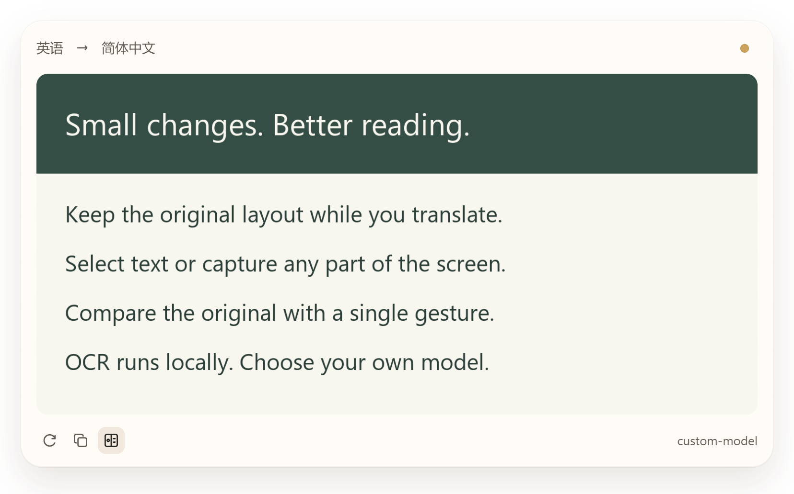
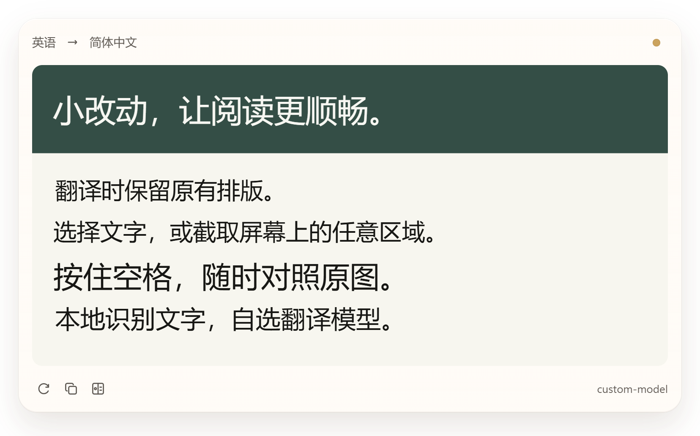
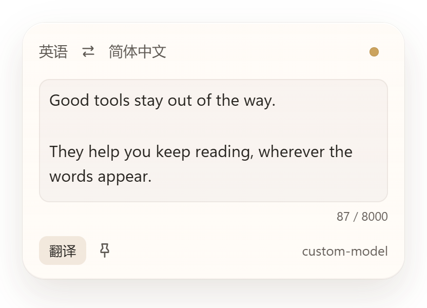
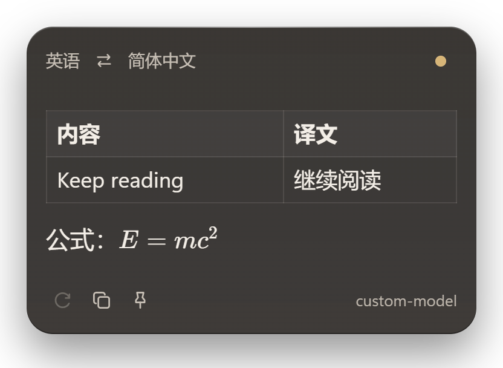
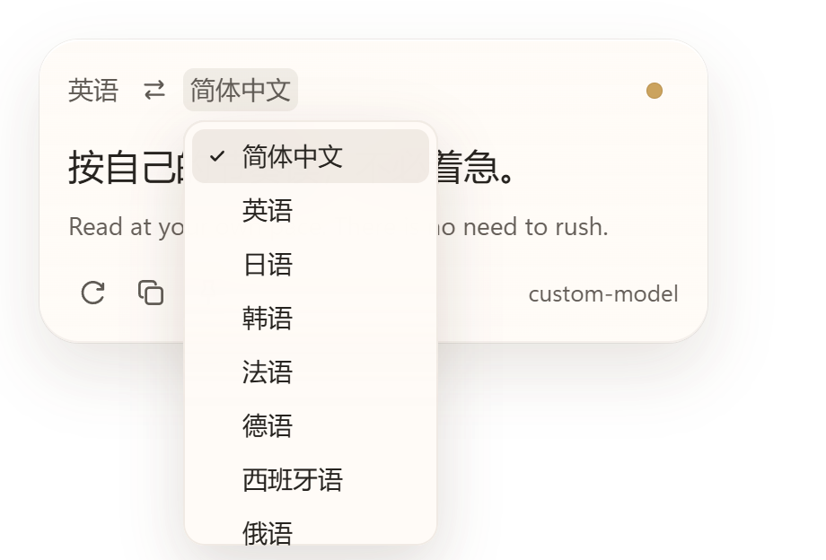
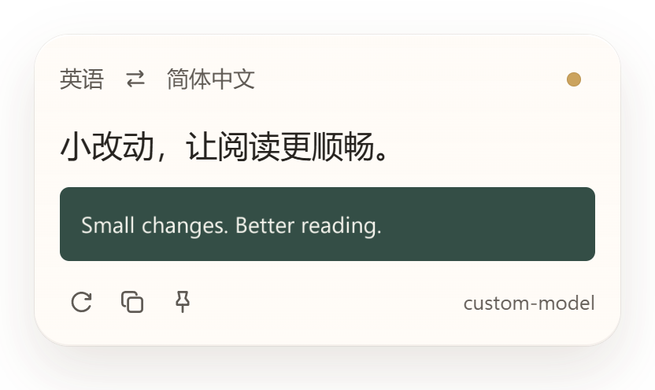
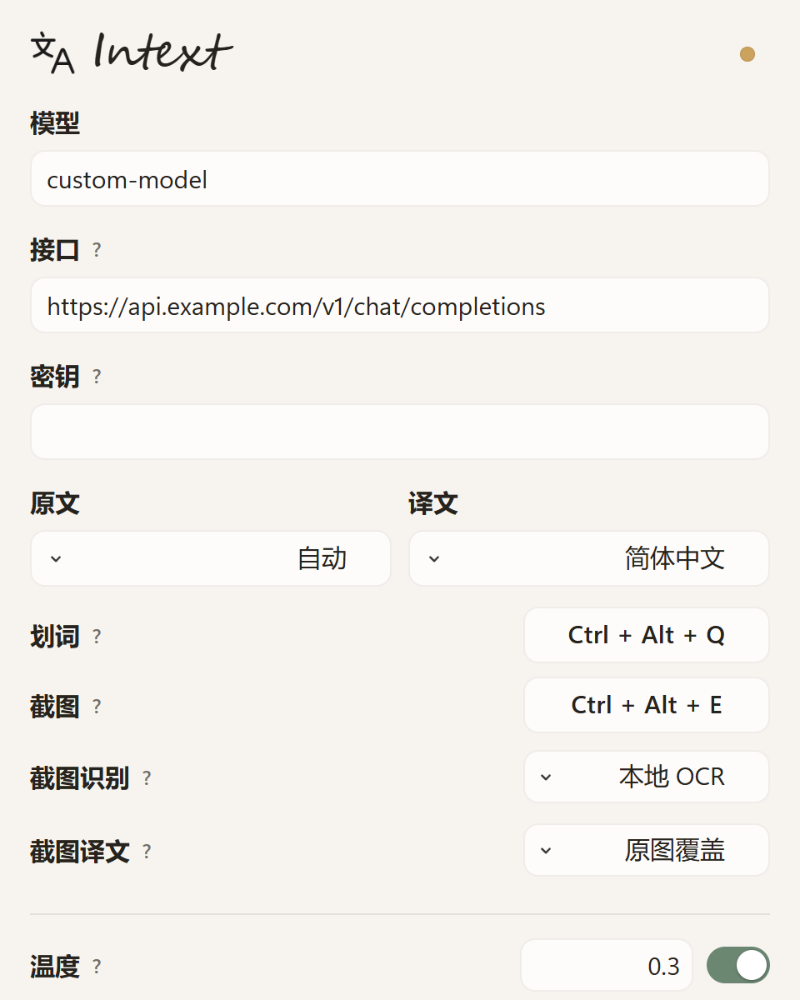
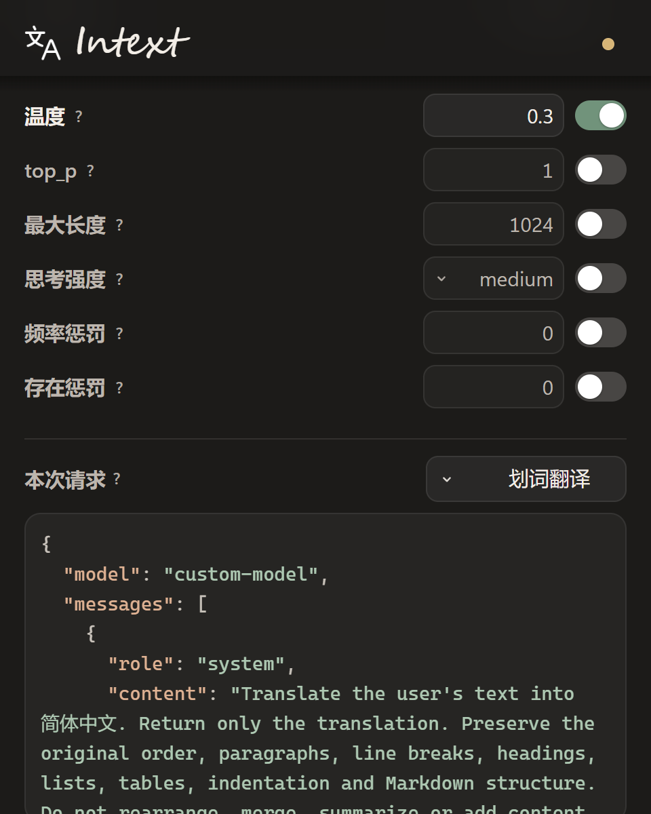

# Intext

Windows 划词与截图翻译工具。选中文字、按下快捷键，在原处看译文。

读网页、论文或文档时，不必来回复制到翻译页面。图片里选不中的文字，也可以截图翻译；想保留排版，就把译文覆盖到原图，按住空格随时对照。

[下载 Windows 安装包](https://github.com/yoashau/Intext/releases/latest/download/Intext-Setup.exe) · [版本记录](https://github.com/yoashau/Intext/releases) · [反馈问题](https://github.com/yoashau/Intext/issues)

| 浅色 | 深色 |
| :---: | :---: |
|  |  |

## 用起来是什么样

- 选中文字后按 **Ctrl + Alt + Q**，译文出现在鼠标旁。浮层可以拖动、固定、复制，也可以直接切换语言或重新翻译。
- 按 **Ctrl + Alt + E** 截图，翻译图片、扫描件或无法选中的文字。支持矩形选区和按住 **Ctrl** 自由圈选。
- 截图译文可以放在浮层里，也可以覆盖到原来的文字位置，保留图片的布局。点击原图按钮或按住空格就能对照。
- 使用自己的接口和模型。兼容 Chat Completions 的服务可自行配置，支持图片输入的模型还可以直接读图。
- 本地 OCR 随安装包提供，无需首次下载模型。默认只把识别出的文字发给翻译服务。
- 翻译结果保存在本机，相同内容可以复用，重启后仍有效。点击「再译」会重新请求，更新缓存。

### 截图翻译，原图对照

下面两张图来自同一张截图。译文按识别出的文字位置覆盖，原图始终保留，可以随时切回来。

| 原图 | 译文覆盖 |
| :---: | :---: |
|  |  |

### 输入、排版与语言切换

右键托盘图标可以打开输入翻译，粘贴文本后按 **Ctrl + Enter** 提交。译文支持 Markdown 标题、列表、表格、代码和 LaTeX 公式。

| 输入翻译 | 表格与公式 |
| :---: | :---: |
|  |  |

| 切换语言 | 截图译文浮层 |
| :---: | :---: |
|  |  |

界面跟随系统深浅色，平时驻留托盘。未固定的浮层在点击外部后收起；固定后可通过右上角圆点或 **Esc** 关闭。

截图使用当前 `main` 分支的界面、演示内容与示例配置。已发布安装包的功能以[对应版本说明](https://github.com/yoashau/Intext/releases)为准。点击图片可查看原尺寸，所有界面截图均以 2 倍像素截取。

## 开始使用

适用于 **Windows x64**。安装包包含 Python 运行环境，无需单独安装 Python；界面使用系统的 Microsoft Edge WebView2 Runtime。

1. 下载并运行 [Intext-Setup.exe](https://github.com/yoashau/Intext/releases/latest/download/Intext-Setup.exe)。
2. 左键点击托盘图标，填写接口完整地址、API key 和模型名称，选择目标语言。设置自动保存。
3. 选中一段文字，按 **Ctrl + Alt + Q**。

需要自行准备可用的模型接口，服务费用按所用服务的规则计算。升级时直接运行新版安装包，已有配置和缓存会保留。两个全局快捷键都可以在设置中修改。

| 接口、语言与快捷键 | 高级参数与请求预览 |
| :---: | :---: |
|  |  |

接口地址需要填到 **Chat Completions 完整路径**，例如 `https://api.example.com/v1/chat/completions`。模型名称以服务提供的名称为准。

温度、思考强度等高级参数默认不发送，需要时再启用。设置页底部可以查看实际请求的 JSON，不显示密钥；参数含义放在旁边的问号提示里。

## 截图模式怎么选

「截图识别」决定模型收到什么，「截图译文」决定结果显示在哪里。默认是「本地 OCR＋翻译浮层」。

| 截图识别 | 截图译文 | 处理方式 |
| --- | --- | --- |
| 本地 OCR | 翻译浮层 | 在本机识别文字，发送文字给模型，译文显示在浮层中 |
| 图片直译 | 翻译浮层 | 将圈选截图交给支持图片的模型，不依赖本地 OCR 识别内容 |
| 本地 OCR | 原图覆盖 | 在本机识别文字和位置，模型翻译文字，再按原位置覆盖 |
| 图片直译 | 原图覆盖 | 本地 OCR 定位文字，将整张圈选截图及各区域文字交给模型，结合图像上下文翻译后覆盖 |

日常读清晰文字，用本地 OCR 即可。遇到艺术字体、符号或 OCR 认错的内容，可以尝试图片直译；需要保留图片布局时，再选原图覆盖。

原图覆盖的两种模式都依赖本地 OCR 定位。图片直译可以借助整图纠正区域中的文字，但不能补出 OCR 漏掉的区域；这种情况更适合「图片直译＋翻译浮层」。模型收到的是整张圈选截图，并不是逐块裁剪的小图。

覆盖模式适合文字清晰、背景较简单的图片，使用周边颜色遮盖原文，不做复杂背景的生成式修复。译文过长时，可悬停或聚焦查看完整内容。

## 数据留在哪里

配置、API key 和翻译缓存保存在 `%APPDATA%\Intext`。翻译请求直接发往你配置的服务。

- 划词、输入翻译和本地 OCR 模式发送文字。本地 OCR 使用随安装包提供的 PP-OCRv5 模型，在程序内运行；本地识别不代表翻译也离线。
- 图片直译会发送圈选截图。自由圈选外的像素会先被清除，图片本身不写入翻译缓存。
- 划词、输入与「本地 OCR＋翻译浮层」共用文本缓存，按原文、语言、接口、模型和请求参数区分；图片直译和原图覆盖使用各自的缓存。相同内容正在翻译时，重复触发会共用请求。

## 常见问题

**划词后取不到文字？**

部分应用不支持读取选区，可以改用截图翻译。截图基于触发时冻结的画面，按 **Esc** 或右键取消选区。

**OCR 没认出文字？**

确认安装包完整。自动识别默认使用中英日模型；法语、德语、西班牙语、韩语、俄语可在原文语言中指定，使用对应模型。复杂字体、小字或公式也可以尝试图片直译，接口和模型需支持图片输入。

**接口报错或提示参数不支持？**

先核对完整地址、模型名称和密钥，再关闭已启用的高级参数重试。错误提示旁的问号可以查看完整原因。

## 从源码运行

需要 Windows 和 Python 3.11 或更新版本：

```powershell
python -m venv .venv
.\.venv\Scripts\python.exe -m pip install -e ".[windows]"
.\.venv\Scripts\python.exe packaging/prepare_ocr.py
.\.venv\Scripts\python.exe -m intext
```

运行单元测试：

```powershell
.\.venv\Scripts\python.exe -m unittest discover -s tests
```

打包使用 [`packaging/build.ps1`](packaging/build.ps1)。脚本会扫描程序目录和安装包，Defender 检测通过后才复制安装包到下载目录，同时生成记录 SHA-256 和扫描结果的 `Intext-Setup.verification.json`。脚本不修改系统保护设置；扫描结果代表当时的本机检测结果。

已打包程序可以通过 `Intext.exe --check-ocr <本机图片路径>` 检查 OCR，退出码为 0 表示识别到了文字，不发送翻译请求。

## 使用的项目

本地 OCR 使用 [RapidOCR](https://github.com/RapidAI/RapidOCR)、[PP-OCRv5](https://github.com/PaddlePaddle/PaddleOCR) 和 [ONNX Runtime](https://github.com/microsoft/onnxruntime)，模型下载固定版本并校验 SHA-256。第三方许可证随安装包提供。

界面使用 [pywebview](https://github.com/r0x0r/pywebview)。Markdown 和公式由本地打包的 [markdown-it](https://github.com/markdown-it/markdown-it)、[KaTeX](https://github.com/KaTeX/KaTeX) 渲染，不加载模型输出中的远程图片或原始 HTML。
