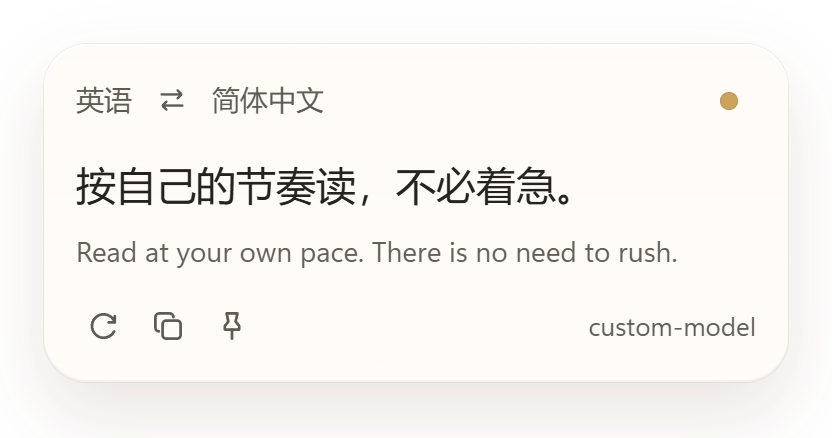
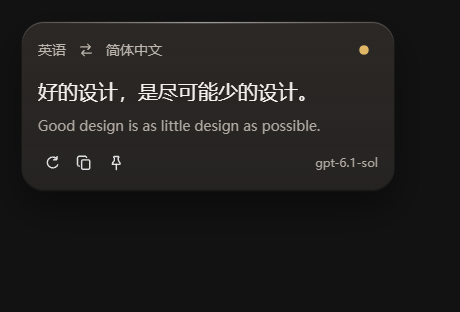

# Intext

**Windows 全局划词与截图翻译，让译文留在阅读的位置。**

选中文字，按下快捷键，译文就会出现在鼠标旁。遇到图片或无法选中的文字，可以截图翻译；也可以直接粘贴多段文本。接口和模型由你选择。

[**下载 Windows 安装包**](https://github.com/yoashau/Intext/releases/latest/download/Intext-Setup.exe) · [查看版本](https://github.com/yoashau/Intext/releases) · [反馈问题](https://github.com/yoashau/Intext/issues)

| 浅色模式 | 深色模式 |
| --- | --- |
|  |  |

## 功能与特点

- **在原处读译文**：选中文字后呼出翻译浮层，原文与译文一起显示，保留段落格式，无需复制到另一个网页。
- **选不到，也能翻译**：选择图片、扫描件或其他无法选中文字的区域，在本机识别文字后翻译，也可让多模态模型直接读图。
- **译文留在原图**：可选择将译文覆盖到截图中的文字位置，并随时对照原图。
- **使用自己的模型**：支持兼容 Chat Completions 的接口，自行填写服务地址、API key 和模型名称。
- **适合连续阅读**：浮层可固定、拖动和复制译文，直接切换语种、对调翻译方向，或重新翻译当前内容。
- **减少重复请求**：已翻译内容保存在本机，重启后仍可复用；相同内容在翻译完成前重复触发时，共用一次请求。
- **融入桌面**：跟随系统深浅色，日常驻留托盘，支持自定义快捷键与开机静默启动。

## 下载与开始使用

适用于 **Windows x64**。安装包已包含 Python 运行环境，无需单独安装 Python；界面依赖系统中的 Microsoft Edge WebView2 Runtime。

1. 下载 [Intext-Setup.exe](https://github.com/yoashau/Intext/releases/latest/download/Intext-Setup.exe)，安装后启动 Intext。
2. 在设置中填写完整的接口地址、API key 和模型名称，选择目标语言。设置会自动保存。
3. 选中一段文字，按 **Ctrl + Alt + Q** 查看翻译。

需要自行准备翻译服务的接口与模型；服务费用按你所用服务的规则计算。升级时直接运行新版安装包，已有配置和缓存会保留。

## 三种翻译方式

| 方式 | 操作 | 适合的内容 |
| --- | --- | --- |
| 划词翻译 | 选中文字，按 **Ctrl + Alt + Q** | 网页、文档、邮件中可以选中的文字 |
| 截图翻译 | 按 **Ctrl + Alt + E**，拖动选择矩形；按住 **Ctrl** 可自由圈选 | 图片、扫描件和无法选中的文字 |
| 输入翻译 | 右键托盘图标 → **输入翻译** | 粘贴的多段文本或手动输入的内容 |

两个全局快捷键都可以在设置中修改。输入翻译支持 **Ctrl + Enter** 提交。

截图快捷键下方提供两个选项，可以自由搭配：

- **截图识别**：默认「本地 OCR」，使用随安装包提供的 PP-OCRv5 模型；「图片直译」将圈选图片发送给你配置的多模态模型。
- **截图译文**：默认「翻译浮层」，可显示 Markdown 标题、列表、表格、代码和 LaTeX 公式；「原图覆盖」按本地识别出的文字位置显示译文，可点击原图图标或按住空格对照，拖动窗口边缘调整大小。

截图基于触发时冻结的画面，选区保持原亮度，圈外变暗；自由圈选使用轻度路径平滑与边缘抗锯齿，预览和最终截图沿用同一路径，圈外像素会清除。按 **Esc** 或右键取消。原图覆盖适合文字清晰的页面，复杂背景不做生成式修复；长译文可悬停或聚焦查看完整内容。图片直译配合原图覆盖时，仍需本地 OCR 定位文字。

浮层中可以复制、固定或重新翻译；点击语言名称切换语种，点击对调按钮做反向翻译。未固定时，点击外部会收起浮层；固定后仍可通过关闭圆点或 **Esc** 关闭。

左键托盘图标打开设置，右键可进入输入翻译、设置开机启动或退出。

## 接口配置

填写服务提供的 **Chat Completions 完整地址**，例如 `https://api.example.com/v1/chat/completions`，以及对应的 API key 和模型名称。

温度、思考强度等高级参数默认不发送。确实需要且模型支持时再启用；设置页底部会显示将要发送的请求内容，不显示密钥。

## 数据与隐私

API key、配置和翻译缓存保存在本机的 `%APPDATA%\Intext`。翻译时，选中的文字会发送到你配置的服务。截图默认由 PP-OCRv5 在本机识别，翻译接口只接收识别出的文字；选择「图片直译」时，会将清除圈外像素后的截图发给该接口。图片本身不写入翻译缓存。

本地 OCR 使用 ONNX Runtime 在程序内运行，不启动 PowerShell 或执行编码脚本。模型随安装包提供，识别时无需下载。第三方模型与库的许可证随安装包提供。

划词、输入翻译与「本地 OCR＋翻译浮层」共用文本缓存，按原文、语言方向、接口、模型、提示词与已启用参数区分。相同文字出现在不同截图中也可复用；段落、缩进等结构差异仍会保留。「图片直译」与「原图覆盖」保留各自的图片或区域缓存。点击「再译」会重新请求服务并更新对应缓存；相似但不同的句子不会直接套用旧译文。

## 常见问题

**选中文字后没有取得内容？**

部分应用不支持读取选区，可以改用截图翻译。

**截图无法识别文字？**

请确认安装包完整。自动识别优先使用中英日模型；法语、德语、西班牙语、韩语、俄语可在「原文」中指定，使用对应的识别模型。复杂排版、小字或公式可尝试「图片直译」，所选模型与接口需要支持图片输入。

**接口提示参数不支持？**

先关闭已启用的高级参数，再核对服务地址和模型名称。浮层提示旁的问号可查看完整失败原因。

## 从源码运行

需要 Windows 和 Python 3.11 或更新版本。在项目目录执行：

```powershell
python -m venv .venv
.\.venv\Scripts\python.exe -m pip install -e ".[windows]"
.\.venv\Scripts\python.exe packaging/prepare_ocr.py
.\.venv\Scripts\python.exe -m intext
```

运行单元测试：

```powershell
.\.venv\Scripts\python.exe -m unittest discover -s tests
```

Windows 打包脚本为 `packaging/build.ps1`。脚本会分别扫描程序目录和安装包，Defender 检测通过后才把安装包复制到下载目录，并附带 `Intext-Setup.verification.json`，记录病毒库版本、扫描结果和 SHA-256。扫描要求启用 Defender 与实时保护，不修改排除项或保护设置。扫描结果只代表当时的本机检测结果。

排查已打包程序的 OCR 时，可运行 `Intext.exe --check-ocr <本机测试图片路径>`，退出码为 0 表示识别到了文字；此检查不发送翻译请求。

OCR 推理使用 [RapidOCR](https://github.com/RapidAI/RapidOCR) 与 [PP-OCRv5](https://github.com/PaddlePaddle/PaddleOCR)。模型下载固定版本并校验 SHA-256。Markdown 与公式渲染使用本地打包的 markdown-it、KaTeX；原始 HTML、远程图片和可点击模型链接不参与渲染。
